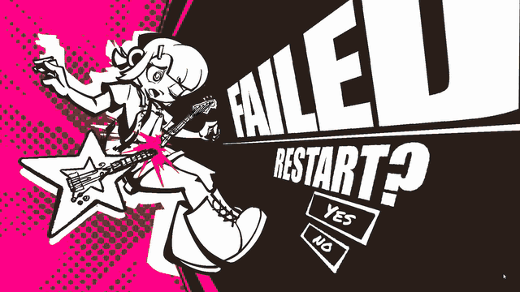

# Rock & Ghoul

A 2D action game on our own custom C++ engine. You play Rock, one half of the guitar duo Rock & Ghoul. Minutes before their set at Jam Out SG, Ghoul steps away and malicious spirits attack. Rock fights her way to the stage with a guitar that now casts spells, entered as arrow-key combos like notes on a fretboard.



---

## About

| | |
|---|---|
| **Genre** | 2D action |
| **Engine** | Custom, written from scratch in C++17 |
| **Libraries** | OpenGL, GLFW, GLEW, ImGui, ImGuizmo, FMOD, nlohmann/json, Mono (C#), FFmpeg |
| **Team** | 8 people, Avid Divas: 6 programmers, 1 designer, 1 artist |
| **Course** | CSD2401 and CSD2451 (two back-to-back modules), Singapore Institute of Technology × DigiPen |
| **Timeline** | Sep 2025 – Feb 2026 |

### What the engine does
- **Entity-component-system** architecture, with 16 component types
- **ImGui level editor** (press `F1`): prefab placement, transform gizmos, and undo up to 20 steps
- **JSON scenes and prefabs**, saved and loaded through each component's own save and load code
- **Scripting** in C++ behaviours and in C# through Mono
- **FMOD audio**, **FFmpeg video cutscenes**, keyboard and controller input

## My role: Tan Jun Quan

**Project manager and programmer.** I owned the engine's ECS core and the sprite and animation code, and co-built the combat.

- **Built the entity-component-system core.**
  - Entities are plain IDs, recycled when destroyed.
  - Each component type gets its own templated storage.
  - A central registry lets teammates register new component types with one call, without editing engine code. The team added 16 this way.
- **Made components plug into saving and the editor.** Every component provides its own save, load and editor hooks. A new component appears in JSON scene files and in the ImGui editor with no extra engine work.
- **Co-built the combat system.** Elemental attacks with four status effects (stun, burn, knockback, slow) and projectile lifecycles. I also co-wrote the enemy AI state machine (idle, roam, chase, return).
- **Built the sprite and animation code and the import process**, and explained to our artist how the engine reads sprite sheets and animations, so the art could be made to fit.
- **Built the C++ behaviour scripting component** and the event bus that systems use to message each other.
- **Ran the project** for 8 people across programming, design and art. I mediated between disciplines and helped our artist visualise VFX animations.

**Where to look in the code**

| Area | Files |
|---|---|
| ECS core | [`EntityManager`](CoreEngine/include/EntityManager.h) · [`ComponentManager`](CoreEngine/include/ComponentManager.h) · [`Registry`](CoreEngine/include/Registry.h) · [`Component.h`](CoreEngine/include/Component.h) |
| Sprites and animation | [`Sprite`](CoreEngine/include/Sprite.h) · [`Animator`](CoreEngine/include/Animator.h) |
| Scripting and events | [`BehaviourComponent`](CoreEngine/include/BehaviourComponent.h) · [`LogicSystem`](CoreEngine/src/LogicSystem.cpp) · [`EventBus`](CoreEngine/include/EventBus.h) |
| Gameplay | [`CombatSystem`](RockAndGhoul/src/CombatSystem.cpp) · [`EnemySystem`](RockAndGhoul/src/EnemySystem.cpp) (shared) · [`PlayerSystem`](RockAndGhoul/src/PlayerSystem.cpp) (shared) |

## Development notes

### Building the ECS
**Constraint:** the ECS was the foundation everyone else would build on, but I had no prior experience with one. I spent two days straight reading articles and watching videos until I understood how the pieces fit together before building it in under a week.

**The choice:** I came across sparse sets in my reading, but couldn't make sense of them at the time. I opted to store each component type in a `std::unordered_map<Entity, T>` as it was much simpler for me to understand and implement at the time.

**What I'd change now:** Would attempt to use sparse sets instead of unordered maps for better optimization.

### ECS Serialization
**What bothered me:** every component has three hand-written functions: one to save, one to load, and one to show it in the editor. Adding a single field means updating all three, and forgetting one causes bugs that are hard to spot, very convoluted especially for more complex components.

**What I'd try next time:** rather than each component having to declare a separate save + load + editor function, have each component simply register it's fields in the Register_Component (name, type), and have the save/load/editor functions as template loops that happen when a component has been registered, reducing the amount of manual code required when adding in a new component.

## Controls

### Keyboard and mouse
| Action | Key |
|---|---|
| Move | `W` `A` `S` `D` |
| Dash | `Left Shift` |
| Melee attack | `E` |
| Choose element | `Q` |
| Enter spell sequence | Arrow keys (see spells below) |
| Activate spell slot | `1` / `2` / `3` |
| Advance dialogue | `Space` |
| Pause / skip cutscene | `Esc` |
| Toggle fullscreen | `Alt` + `Enter` |

**Spells:** Soundwave `↑ ↓` · AOE `↑ ← ↓` · Shield `↓ ↓ →` · Healing `→ ↑ →`

<details>
<summary><b>Controller</b></summary>

| Action | Button |
|---|---|
| Move | Left stick |
| Dash | `A` |
| Melee attack | `RB` |
| Choose element | `LB` |
| Enter spell sequence | Hold `LT` + `Y` (↑) / `X` (←) / `B` (→) / `A` (↓) |
| Activate spell slot | `X` / `Y` / `B` |
| Advance dialogue | `A` |
| Pause / skip cutscene | `Start` / `Back` |
| Navigate menus | Left stick / D-pad, confirm with `A` / `B` |

</details>

<details>
<summary><b>Editor and debug</b></summary>

| Action | Input |
|---|---|
| Toggle ImGui editor | `F1` |
| Toggle FPS display | `F3` |
| Memory stats in console | `P` |
| Place prefab | Click in game view |
| Cancel prefab placement | `0` |
| Delete (JSON / prefab list) | Right-click |
| Move / zoom editor camera | Drag in camera panel / mouse wheel |
| Gizmo: move, rotate, scale | `W` / `E` / `R` |
| Undo (up to 20 steps) | `Ctrl` + `Z` |

</details>

## Building from source

**Requirements:** Windows, Visual Studio 2022, [CMake](https://cmake.org/download/) (add it to your PATH during install), and the .NET Framework 4.7.2 or 4.8 Developer Pack.

**Before building:**
- Extract `deps/FFmpeg.zip` into `deps/FFmpeg/`. The unzipped folder isn't in the repo.
- FMOD's libraries (`deps/fmod/lib`) and Mono (`deps/Mono`) aren't in the repo either. [TODO: say where to get them.]

Then, from a Visual Studio developer command prompt, in the repo folder:
```
mkdir build
cd build
cmake ..
cmake --build . --config Release
```
Or open `build/team_aviddivas.sln` and set it as the startup project. Debug and Release x64 builds are supported. To regenerate after changing `CMakeLists.txt`, delete the `build/` folder and run the commands again.

## Team: Avid Divas

| Name | Role |
|---|---|
| Wong Shi Yu Regine | Tech lead, programmer |
| Tan Jun Quan | Project manager, programmer |
| Kervin Guan Cheng Ong | Graphics lead, Programmer |
| Yasmin Tazi | Programmer |
| Manfred Sim | Programmer |
| Tan Ying Clarissa | Audio lead, programmer |
| Danny Shannon Wong Jia Jun | Design lead, UI/UX designer |
| Kelly Keli Goh | Artist |

## License

Student project created at DigiPen Institute of Technology Singapore / Singapore Institute of Technology.
All content © 2025–2026 DigiPen (USA), LLC. All rights reserved. Shared for portfolio purposes only.
Third-party libraries (FMOD, FFmpeg, ImGui, GLFW and others) remain under their own licences.
